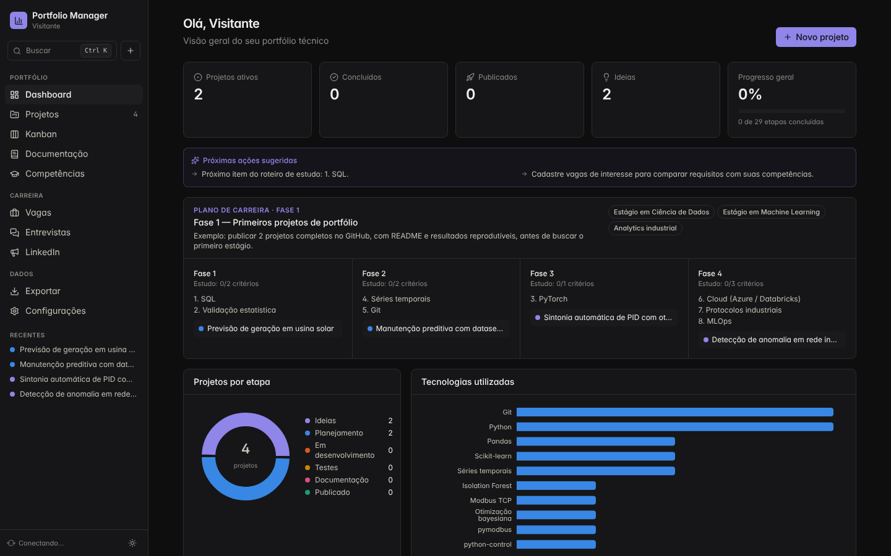

# Portfolio Manager

**[Abrir a demonstração online](https://victor-alrib.github.io/portfolio-manager/)**

Aplicação web (React + TypeScript) para organizar, acompanhar e documentar projetos de portfólio técnico e a preparação para vagas, com uma regra embutida que impede o sistema de inventar métricas ou resultados.



> Este **não é um projeto de Machine Learning**: não há modelo treinado nem dataset. É uma ferramenta de apoio ao meu roadmap de estudos em IA aplicada à indústria.

---

## Problema

Tenho um roadmap de estudos com 8 competências (SQL, validação estatística, PyTorch, séries temporais, Git, cloud, protocolos industriais e MLOps) e 4 projetos de portfólio planejados. Na prática, ficava difícil:

- saber em que etapa cada projeto está e o que falta;
- ligar o que eu estudo aos projetos onde vou aplicar;
- documentar cada projeto (README, entrevistas, LinkedIn) **sem exagerar resultados**;
- comparar os requisitos das vagas com o que eu já desenvolvi.

O Portfolio Manager reúne tudo isso num só lugar.

## Abordagem

### Dados
- **Não há dataset.** A versão pública vem com **dados de exemplo fictícios** (4 projetos, um roteiro de 8 competências e um plano de carreira genérico) para demonstrar o app. Tudo pode ser editado ou apagado em Configurações.
- Os projetos de exemplo entram como **planejados ou ideias**: nenhuma etapa concluída e nenhum resultado. Os prazos são contados a partir do primeiro uso.

### Técnicas e por que cada escolha

| Escolha | Por quê |
|---|---|
| **React 18 + TypeScript** | Pedido do projeto; os tipos (`src/types.ts`) documentam o modelo de dados e evitam erros em um estado grande. |
| **Zustand** (estado global) | Um único store com ações nomeadas e quase nenhum boilerplate (`src/store/store.ts`). |
| **Persistência em duas camadas** | `localStorage` como cache imediato. Quando hospedado no claude.ai, cada entidade vira um documento no armazenamento privado da conta, e só o que mudou é gravado (`src/store/sync.ts`). |
| **Modelo versionado + migração** | `migrate()` normaliza dados antigos ou importados, o que permite backup e restauração em JSON. |
| **Regra de integridade** | Seções vazias viram `[A preencher]`, "Resultados" vazio vira um aviso, e números em resultados não confirmados são rotulados como preliminares. Uma expressão regular (`findNumericClaims`) detecta possíveis métricas e alerta. |
| **Aderência a vagas** | Pontuação ponderada: Σ min(nível atual, nível exigido) ÷ Σ nível exigido, com requisitos obrigatórios valendo 2×. Os requisitos colados são mapeados para competências por palavras do nome (heurística). |
| **Recharts / jsPDF** | Gráficos interativos com tooltip; PDFs gerados no próprio navegador, sem servidor. |
| **Build em arquivo único + rotas por hash** | O ambiente onde o app é hospedado (iframe isolado) só aceita rotas `#nome` e bloqueia downloads diretos, `alert` e `confirm`. Por isso o app usa diálogos próprios e o recurso de downloads do host, com o download normal do navegador como alternativa. |

### Funcionalidades
Dashboard · Projetos (etapas, datas, arquivos, links, anotações, competências) · Kanban com 6 colunas e arrastar e soltar · Gerador de README em 8 seções · Competências (roteiro, níveis de 0 a 5, vínculo com projetos) · Vagas (requisitos × competências) · Ficha de entrevista no formato STAR · Rascunhos para LinkedIn · Exportação (README `.md`, PDF de resumo, relatório de progresso em PDF/MD, JSON) · Tema escuro e claro · Busca com Ctrl+K.

## Resultados

Não há métricas de modelo, porque não é um projeto de ML. As verificações são do funcionamento técnico (logs em [`resultados/logs`](resultados/logs)):

| Verificação | Resultado |
|---|---|
| Checagem de tipos (`tsc --noEmit`) | 0 erros |
| Build de produção | 3067 módulos, 1 arquivo HTML de 1.557,08 kB (466,95 kB com gzip) |
| Código-fonte | 34 arquivos `.ts`/`.tsx`, 4.718 linhas em `src/` |
| Teste E2E (Playwright, Chromium) | 11 telas carregadas; arrastar e soltar no Kanban e as setas movem o card; criação de projeto e de etapa; 4 downloads gerados (README, JSON e 2 PDFs); dados mantidos após recarregar; nenhum erro no console |
| Teste de sincronização (banco **simulado**) | Primeira carga gera 17 documentos; alterar 1 projeto gera 2 gravações (o projeto e o carimbo `meta`) |

Capturas de tela em [`resultados/capturas`](resultados/capturas) e exemplos de saída (PDFs, README gerado, backup JSON) em [`resultados/exemplos-de-saida`](resultados/exemplos-de-saida).

## Como rodar

Pré-requisito: [Node.js](https://nodejs.org) (usei a v22) e npm.

```bash
npm install          # instala as dependências do package-lock.json
npm run dev          # abre em http://localhost:5173
```

Para gerar a versão final (um único HTML que funciona offline):

```bash
npm run build        # gera dist/index.html
```

Sem instalar nada, dá para abrir direto o arquivo já compilado em [`demo/portfolio-manager.html`](demo/portfolio-manager.html) no navegador (baixe e abra localmente). Fora do claude.ai, os dados ficam salvos no `localStorage` daquele navegador.

Testes E2E (opcionais):

```bash
npm i -D playwright@1.63.0
npx playwright install chromium
npm run build
npm run test:smoke   # também: npm run test:fluxos, npm run test:sync
```

As capturas e arquivos dos testes são gravados em `testes/saida/`. Para usar um Chrome já instalado em vez de baixar o Chromium, defina `CHROME_PATH` com o caminho do executável.

**Publicação:** o workflow `.github/workflows/deploy.yml` publica o app no GitHub Pages a cada push na `main`.

**Chaves e segredos:** o projeto **não usa nenhuma chave de API, senha ou token** e não precisa de variáveis de ambiente. Se um dia for integrado a algum serviço (por exemplo, a API do GitHub), a chave deve vir de uma variável de ambiente num arquivo `.env`, que já está no `.gitignore`, e nunca ser escrita no código.

## Limitações

- **Sincronização entre dispositivos só acontece ao abrir o app** (não é em tempo real). Em conflito vence a versão com carimbo mais recente, e ela substitui a outra inteira.
- A sincronização com o armazenamento do claude.ai foi testada com um banco simulado em memória.
- **Não há testes unitários.** Os testes são scripts E2E que imprimem valores conferidos manualmente; não há asserts automáticos.
- Os testes de interface rodaram no Chromium headless, em 1440 px e 390 px de largura.
- O mapeamento requisito → competência e a detecção de métricas são heurísticas (palavras e expressão regular): podem errar.
- Anexos embutidos estão limitados a 150 KB cada; para arquivos maiores, registra-se o caminho ou link.
- O bundle tem cerca de 1,5 MB (o jsPDF pesa bastante) porque tudo vai num único arquivo.
- O arrastar e soltar nativo não funciona em telas de toque (as setas nos cards são a alternativa).
- A interface só existe em português.
- Na tabela de vagas, a coluna com o nome do requisito fica estreita e corta o texto (ver `resultados/capturas/12-vaga-requisitos-x-competencias.png`).

## Próximos passos

- Testes unitários (ex.: Vitest) para `metrics.ts`, `markdown.ts` e `migrations.ts`.
- Sincronização em tempo real e resolução de conflito por item.
- Carregar o gerador de PDF sob demanda para reduzir o bundle.
- Integração com a API do GitHub para ler o status real dos repositórios.
- Auditoria de acessibilidade e desempenho (Lighthouse) e teste com usuários.

## Stack

React 18.3.1 · TypeScript 7.0.2 · Vite 5.4.21 · Tailwind CSS 3.4.19 · Zustand 5.0.16 · Recharts 3.10.1 · jsPDF 4.2.1 · lucide-react 1.66.0 · Playwright 1.63.0 (testes)

Arquitetura detalhada em [`docs/ARQUITETURA.md`](docs/ARQUITETURA.md).

## Autoria

Desenvolvido por **Victor** (Engenharia de Controle e Automação — IFSP), com auxílio de IA (Claude) na escrita do código e da documentação.

## Licença

[MIT](LICENSE)
